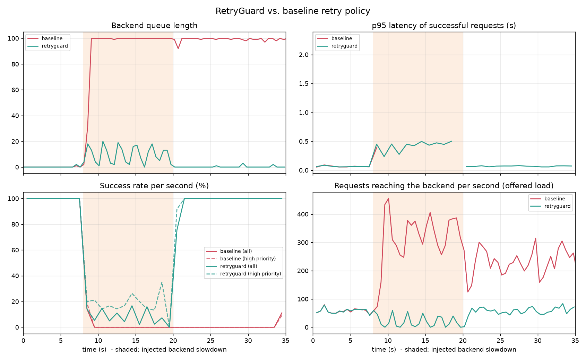

# RetryGuard

**An intelligent queue-aware retry and load-shedding framework for preventing cascading failures in cloud-native microservices.**

Cloud-native systems are collections of small services talking over a network. When one service slows down, callers time out and **retry** — and those extra requests overload the already-struggling service even more (a *retry storm*). Conventional retry logic uses a fixed rule (e.g. "retry 3 times, wait 100 ms") and ignores how congested the system actually is.

RetryGuard is a lightweight decision layer that **monitors → evaluates → decides** for every request:

| Monitor | Evaluate | Decide |
|---|---|---|
| backend queue length, CPU / memory, observed latency, error rate | congestion score, retry history (retry budget), request priority | **retry**, **delay** (congestion-stretched backoff) or **reject / shed** |

This repository is a working, reproducible prototype that compares RetryGuard against a conventional baseline retry policy under an injected service slowdown.

## Architecture

```
            ┌──────────────────────────── Gateway (owns the retry policy) ───────────────────────────┐
 Client ──▶ │  admit?  ──▶ call backend ──▶ failed? ──▶ on_failure(): retry | delay | reject         │ ──▶ Backend
 (load      │     ▲                              │                                                     │     (bounded worker pool,
 generator) │     └────── HealthState ◀──────────┘   polls /health every 100 ms + EWMA latency/errors  │      request queue,
            └───────────  policy = baseline | retryguard   ·   /metrics (Prometheus)  ───────────────┘      fault injection)
```

* `retryguard/policy.py` – the decision logic (pure Python, fully unit-tested)
  * `BaselinePolicy`: fixed retry count + fixed delay.
  * `RetryGuardPolicy`: threshold-based, transparent rules (see below).
* `services/backend.py` – FastAPI service with a limited number of workers, a queue, `/health`, `/metrics` and `/admin/fault` (slow-down / error injection). Like many real services it keeps processing requests whose caller already timed out, which is what makes retry storms damaging.
* `services/gateway.py` – FastAPI gateway; `POLICY=baseline|retryguard`; exposes `/metrics` and `/stats`.
* `experiments/` – open-loop (Poisson) load generator and the experiment runner that produces CSVs, a summary table and plots.

### How RetryGuard decides

1. **Congestion score** = the worst of four normalised signals (1.0 ≈ saturated):
   queue length per worker · EWMA latency vs. SLO · error rate · CPU above 70 %.
   Observed latency/error EWMAs decay over time so the system recovers after shedding.
2. **Admission / load shedding** – before the first attempt, requests are shed with a probability that ramps up with congestion. **Low-priority traffic is shed first**; high-priority traffic is protected until congestion is much higher.
3. **After a failure** –
   * congestion above the per-priority limit → **reject** (don't retry into a struggling service);
   * otherwise a **retry budget** (token bucket, ≈10 % of traffic) must allow it;
   * moderate congestion → **delay** with jittered, congestion-stretched exponential backoff;
   * healthy → quick jittered **retry**.
4. The policy starts rule-based and transparent; it can later be swapped for an ML model if enough representative data is available (implement the same `admit` / `on_failure` interface).

## Quick start

```bash
git clone <your-repo-url> && cd retryguard
python -m venv .venv && source .venv/bin/activate      # Windows: .venv\Scripts\activate
pip install -r requirements.txt

pytest -q                                   # unit + service tests
python -m experiments.run_experiment        # full experiment, ~80 s  -> results/
python -m experiments.run_experiment --quick
```

Options: `--policy baseline|retryguard|both`, `--rate`, `--fault-rate`, `--slow-factor`, `--out DIR`.

### Docker (multi-container setup + Prometheus)

```bash
docker compose up --build                   # POLICY=retryguard by default
POLICY=baseline docker compose up --build   # compare with the baseline

python -m experiments.loadgen --target http://localhost:8100 --rate 60 --duration 30
curl -X POST localhost:8101/admin/fault -H 'content-type: application/json' -d '{"slow_factor": 5}'   # inject slowdown
curl -X POST localhost:8101/admin/reset                                                               # heal
curl localhost:8100/stats                                                                             # live stats
```
Prometheus: <http://localhost:9090> (metrics prefixed `rg_gateway_*` / `rg_backend_*`).

## Experiment

Three phases, same traffic for both policies (20 % high-priority requests, per-attempt timeout 0.5 s):

| Phase | Duration | Load | Backend |
|---|---|---|---|
| warm-up | 8 s | 60 rps | normal (capacity ≈ 100 rps) |
| **fault** | 12 s | 80 rps (burst) | **5× slower** (capacity ≈ 20 rps) |
| recovery | 15 s | 60 rps | normal again |

### Results



| Metric | baseline | retryguard |
|---|---|---|
| Success rate (overall) | 36.0% | 61.0% |
| Success rate (during fault) | 2.6% | 9.1% |
| Success rate (after fault) | 40.4% | 98.6% |
| High-priority success (during fault) | 3.0% | 21.2% |
| p95 latency, successes (s) | 4.458 | 0.240 |
| p99 latency, successes (s) | 4.934 | 0.465 |
| Retries performed | 1473 | 3 |
| Requests shed at admission | 0 | 745 |
| Load amplification (backend reqs / client reqs) | 1.61x | 0.68x |
| Max backend queue length | 100 | 19 |
| Time to recover after fault ends (s) | not recovered | 1 |

(Full table in [`results/summary.md`](results/summary.md), raw per-request and time-series data in `results/*.csv`.)

**What the data shows**

* The baseline turns an 80-request/s load into up to ~240 backend requests/s, fills the backend queue (hard limit 100), and **stays degraded even after the fault is gone** – the queue is full of work for callers that already gave up.
* RetryGuard keeps the queue short, sends fewer requests than clients make (it sheds low-priority work), recovers about a second after the fault ends, and keeps p95 latency of successful requests ~20× lower.
* High-priority requests are served ~7× more often during the fault.

**Honest limitations**

* RetryGuard does not create capacity. During the fault the backend can serve at most ~25 % of the offered load; RetryGuard decides *which* requests get that capacity and prevents the collapse afterwards.
* Shed requests count as failures for the client. The benefit is protecting the service and important traffic, not hiding errors.
* Numbers vary slightly between runs and machines (everything runs on one host, in Python); the *shape* of the curves is what matters. Run `python -m experiments.run_experiment` to reproduce.
* This is a demonstrable prototype with one gateway → one backend hop, not a production-grade platform. Extending it to a chain of services (each with its own policy instance) or to Kubernetes is straightforward future work.

## Repository layout

```
retryguard/        decision logic (policy.py)
services/          backend.py, gateway.py
experiments/       loadgen.py, run_experiment.py
tests/             test_policy.py, test_services.py
results/           committed output of the last full run
docker-compose.yml, Dockerfile, prometheus.yml
.github/workflows/ci.yml   (runs pytest on every push)
```

## Team

* Mokshagna – RA2311031010059
* Vadlamudi Kaavya – RA2311031010067
* Avleen Kaur – RA2311031010113

Cloud-Native Systems – project proposal "RetryGuard". Licensed under MIT.
